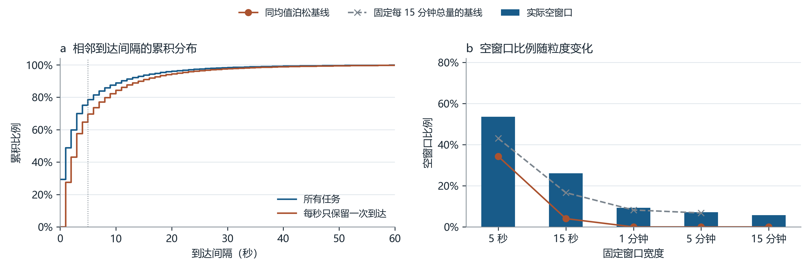
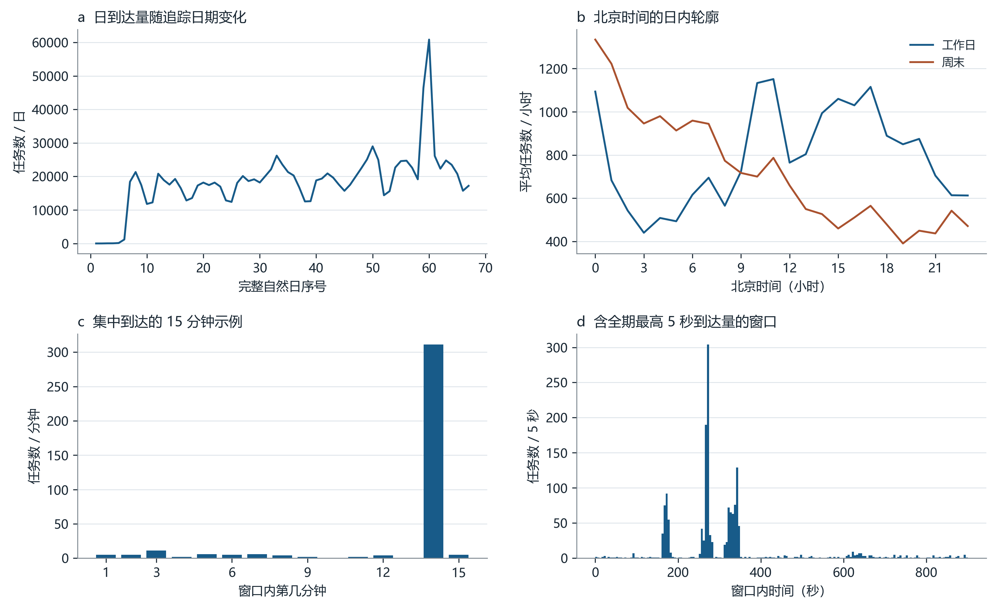
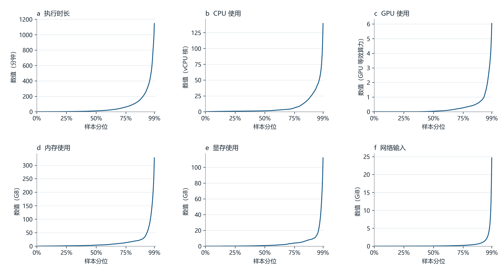
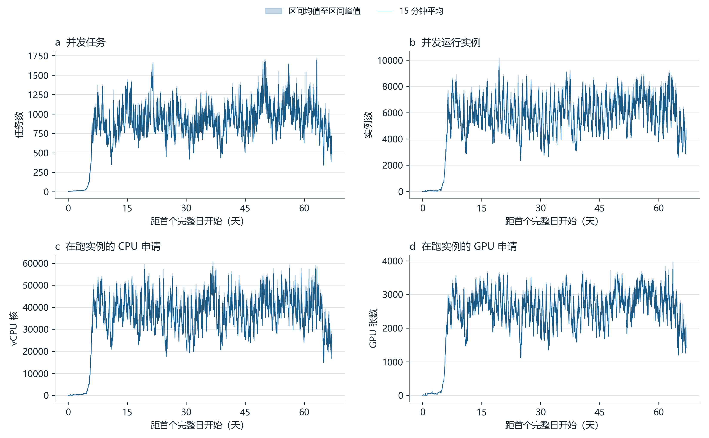
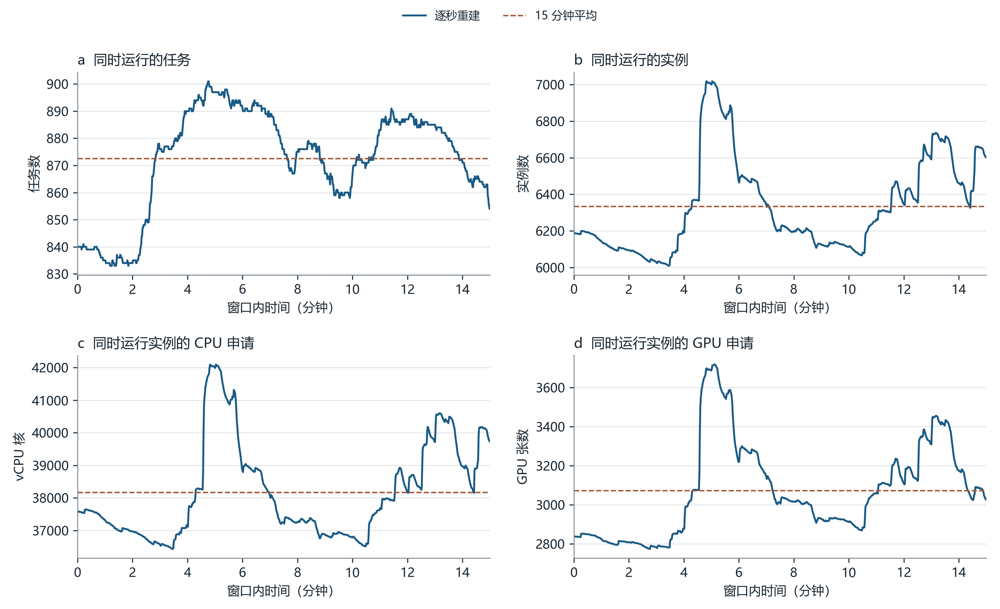

# 阿里巴巴 PAI GPU v2020 任务到达与调度粒度报告

**对于固定步长的 SAC，建议先以 15 秒为基准、5 秒为对照、1 分钟为低频对照。** 5 秒能够保留短时到达突发，但超过一半的 5 秒窗口没有新任务。并发资源比到达量平滑，是否值得每 5 秒行动，应比较排队尾部和单位仿真时间的决策成本。15 分钟可用于上层电力、碳或能量决策，细粒度调度仍需保留原始到达和完成时间。

| 粒度 | 每小时决策步数 | 每窗口平均到达 | 空窗口 | 建议用途 |
|---|---:|---:|---:|---|
| 5 秒 | 720 | 1.07 | 53.54% | 响应突发、空闲时继续处理排队和完成事件 |
| 15 秒 | 240 | 3.21 | 26.09% | 固定步长 SAC 基准 |
| 1 分钟 | 60 | 12.83 | 9.25% | 低频计算调度对照 |
| 5 分钟 | 12 | 64.16 | 7.13% | 粗粒度资源观察 |
| 15 分钟 | 4 | 192.47 | 5.67% | 电力和能量层聚合，保留窗口峰值 |

## 数据与统计口径

- 从官方下载的任务、作业、实例、传感器及机器规格 CSV 计算。主统计使用 **67 个完整北京时间自然日**，即脱敏秒区间 `[576000, 6364800)`。舍弃两端不完整自然日，保留中间低活动日及全部空窗口。时间只解释为日内时刻、星期或相对天数。
- 任务粒度为 `(job_name, task_name)`。原表 1,261,050 行，1,257,336 行有开始时间，完整日包含 **1,237,992 次任务开始**。到达代理使用 `pai_task_table.start_time`，即任务表记录的启动时间，另用同期 **1,035,158 次作业提交**复核。到达统计保留短任务和同秒事件，资源字段缺失不影响到达统计。公开的开始时间精度为秒。
- 五种窗口都按北京时间午夜对齐，使用左闭右开区间，互不重叠。到达间隔和窗口分布采用经验分位数。并发重建保留与观察区间有重叠的记录，包括在左边界前已启动的任务或实例。
- [阿里官方字段与时间定义](https://github.com/alibaba/clusterdata/blob/master/cluster-trace-gpu-v2020/README.md) · [配套 NSDI 论文](https://www.usenix.org/conference/nsdi22/presentation/weng)

## 7.1 相邻任务到达间隔

| 口径 | 最小 | 平均 | P50 | P90 | P95 | P99 | < 5 秒 | < 15 秒 | < 60 秒 |
|---|---:|---:|---:|---:|---:|---:|---:|---:|---:|
| 全部任务开始，67 个完整日 | 0 秒 | 4.67 秒 | 2 秒 | 11 秒 | 18 秒 | 39 秒 | 74.99% | 92.85% | 99.71% |
| 每个到达秒只计一次 | 1 秒 | 6.61 秒 | 3 秒 | 15 秒 | 22 秒 | 44 秒 | 64.64% | 89.89% | 99.59% |
| 作业提交，67 个完整日 | 0 秒 | 5.59 秒 | 2 秒 | 14 秒 | 21 秒 | 43 秒 | 68.28% | 90.58% | 99.62% |
| 全部有效任务开始，含首尾不完整日 | 0 秒 | 4.74 秒 | 2 秒 | 11 秒 | 18 秒 | 39 秒 | 74.97% | 92.83% | 99.71% |

主样本中 29.28% 的相邻间隔为 0 秒，说明这些记录的时间戳相同。即使每秒只计一次，仍有近三分之二的间隔短于 5 秒。最长观测间隔为 **29,463 秒（约 8.18 小时）**，出现在第 1 个完整日。首日仅 17 次到达，数据本身无法判定这段低活动来自业务、追踪覆盖还是两者共同作用。

## 7.2 每个固定窗口的任务数量

| 窗口 | 窗口数 | 平均 | P50 | P90 | P95 | P99 | 最大 | 空窗口 | 至少 2 个任务 |
|---|---:|---:|---:|---:|---:|---:|---:|---:|---:|
| 5 秒 | 1,157,760 | 1.07 | 0 | 3 | 4 | 11 | 304 | 53.54% | 22.05% |
| 15 秒 | 385,920 | 3.21 | 2 | 7 | 11 | 27 | 360 | 26.09% | 55.94% |
| 1 分钟 | 96,480 | 12.83 | 9 | 26 | 39 | 77 | 626 | 9.25% | 88.25% |
| 5 分钟 | 19,296 | 64.16 | 52 | 120 | 158 | 311.1 | 939 | 7.13% | 92.28% |
| 15 分钟 | 6,432 | 192.47 | 166 | 339 | 434 | 798.83 | 2,004 | 5.67% | 93.47% |

空窗口比例的分母是全部固定窗口。5 秒窗口起点分别平移 0 至 4 秒后，空窗口比例在 **53.51%–53.56%** 之间。只看有任务的 15 分钟窗口，其中的 5 秒子窗口仍有 **50.74%** 无新任务。改用作业提交时，5 秒空窗口比例为 **57.90%**。空窗口只表示无新到达，调度器仍可能面对排队任务、运行任务和完成事件。

## 7.3 日内分布与突发性

北京时间 **00:00–01:00** 的总到达量最高，约为最低的 **23:00–24:00 的 2.04 倍**。完整日的到达量中位数为 **18,630**，P95 为 **26,191**，最大为 **60,841**。最初六个完整日各只有 17–1,201 次到达。保留这些天作为主口径，并在下文报告剔除它们后的敏感性结果。

去掉最初六个低活动日后，任务间隔小于 5 秒的占比仍为 **75.04%**，5 秒方差均值比为 **5.23**，最高仍为 **304 个任务 / 5 秒**。五种窗口的空窗口比例依次降为 **49.08%、19.08%、1.03%、0%、0%**。较长窗口的空窗统计对这段追踪边界尤其敏感。

以窗口任务数的方差除以均值衡量离散程度，5 秒为 **5.33**，15 秒为 **9.48**，1 分钟为 **19.50**，5 分钟为 **55.26**，15 分钟为 **133.77**。同均值齐次泊松过程的理论值为 1，5 秒空窗口理论值为 **34.32%**。为考虑较慢的负载变化，再固定每个 15 分钟窗口实际任务总数，让每个任务独立、均匀地落到窗口内。这个基线预计 **43.05%** 的 5 秒子窗口为空，实际为 **53.54%**，相对于条件基线的方差为 **4.61 倍**。因此，15 分钟之间的流量变化只能解释部分短时集中。这个比较是描述性的，既包括业务集中，也可能包括同一作业拆出的任务或追踪记录方式造成的同秒集中。作业口径的条件离散比仍为 **4.79**。

最繁忙的 1% 的 5 秒窗口承载 **16.08%** 的任务。第 61 个完整日 10:49:30 开始的 5 秒内记录了 **304 个任务**，也是作业口径下的峰值。在至少到达 30 个任务的 5,864 个 15 分钟窗口中，最繁忙的 1 分钟通常承载该窗口 **16.0%** 的任务，P95 为 **33.96%**，有 **0.87%** 的窗口把一半以上的任务集中在同一分钟。一个具体例子是第 51 个完整日 05:45–06:00，共 **368 个任务**，其中第 14 分钟到达 **311 个（84.51%）**。

## 7.4 任务异质性

时长以任务表 `end_time - start_time` 计算，统计在完整日内开始、状态为 `Terminated` 且时长为正的 **870,029 个任务**。这个时长从任务表的启动时刻起算，可能包含实例启动前的等待。区间短于 1 分钟、1 至不足 15 分钟、15 至不足 60 分钟、至少 60 分钟的占比依次为 **15.71%、39.11%、19.67%、25.51%**。若沿用仓库示例中过滤掉 15 分钟以下任务的规则，将移除该成功样本的 **54.82%**。

使用量先通过 `worker_name` 匹配实例和传感器，再在任务内对各实例的生命周期均值求和。**574,790** 个成功任务匹配到至少一条传感器记录，占成功样本的 **66.1%**。每项指标保留有该指标观测的任务。求和体现所覆盖实例的资源规模，实例起止不同，不能把这个和解释成某一秒的同时峰值。网络输入使用 `read / 2^30`。为对应仓库字段，同时报告 `bandwidth_gb = (read + write) / 2^30`。两者均来自生命周期内的网络传感汇总，单位按换算为 GiB，无法直接当作单次任务累计输入量或 Gb/s。

| 指标 | 有效任务数 | P50 | P90 | P95 | P99 | 与任务时长的 Spearman ρ |
|---|---:|---:|---:|---:|---:|---:|
| 任务时长（分钟） | 870,029 | 10.8 | 211.4 | 397.4 | 1,145.9 | — |
| CPU 平均使用（vCPU 核） | 573,548 | 1.43 | 27.56 | 45.11 | 139.49 | 0.529 |
| GPU 平均使用（GPU 等效算力） | 574,790 | 0.034 | 0.751 | 1.815 | 6.037 | 0.367 |
| 平均内存（GB） | 574,456 | 3.88 | 29.92 | 82.66 | 327.28 | 0.698 |
| 平均显存（GB） | 574,790 | 0.756 | 9.114 | 18.880 | 111.976 | 0.439 |
| 网络输入（GiB） | 574,790 | 0.043 | 0.868 | 2.296 | 24.655 | −0.078 |
| `bandwidth_gb`，网络读写合计（GiB） | 574,790 | 0.075 | 1.122 | 2.670 | 28.294 | −0.090 |

- **短任务与长任务。** 少于 1 分钟的有监测任务中，CPU 和内存中位数为 **0.77 vCPU 核、0.39 GB**，至少 60 分钟的对应为 **7.63 核、13.48 GB**。GPU 等效使用中位数分别为 **0、0.106**。
- **小任务与大任务。** 以单实例和多实例作为任务规模口径。成功任务中有 **672,000** 个单实例、**198,029** 个多实例。申请量中位数分别为 **6 对 60 vCPU 核、1 对 5 张 GPU、29.30 对 195.31 GB 内存**。GPU 申请只用有记录的样本。多实例任务的观测 CPU 使用中位数为 **10.11 核**，单实例为 **1.18 核**。
- **CPU 与 GPU 密集程度。** 取任务级观测平均使用量达到 **4 vCPU 核**或 **1 GPU 等效算力**为操作阈值。573,548 个两项都有值的任务里，**23.07%** 仅达到 CPU 阈值，**0.82%** 仅达到 GPU 阈值，**6.77%** 两项都达到，**69.35%** 均未达到。比例依赖阈值和监测覆盖，可用来构造仿真负载类型。
- **覆盖敏感性。** 仅保留实例数与 `inst_num` 一致、且每个纳入实例都有传感器记录的 **466,728** 个任务，CPU、GPU、内存、显存和网络输入与时长的 ρ 分别为 **0.516、0.343、0.740、0.432、−0.222**。时长和内存的正相关较强，网络相关性对样本口径更敏感。

## 7.5 并发与资源随时间变化

任务并发按任务表的 `[start_time, end_time)`，实例并发按实例表的 `[start_time, end_time)` 计算。每条有效记录在开始秒加 1、结束秒减 1，再按秒累加。资源申请使用运行实例继承的任务级每实例申请量，`plan_cpu / 100` 得到 vCPU 核，`plan_gpu / 100` 得到 GPU 张数。使用量曲线将每条实例的监测生命周期均值铺回对应的活动区间，反映监测子样本的近似负载。

| 逐秒指标 | 平均 | P50 | P95 | P99 | 最大 |
|---|---:|---:|---:|---:|---:|
| 并发任务 | 843 | 889 | 1,251 | 1,428 | 1,723 |
| 并发实例 | 5,383 | 5,745 | 7,796 | 8,450 | 10,174 |
| 已知 CPU 申请（vCPU 核） | 34,495 | 37,257 | 48,934 | 53,326 | 60,679 |
| 已知 GPU 申请（张） | 2,394 | 2,603 | 3,294 | 3,486 | 3,975.05 |
| 监测子样本近似 CPU 使用（vCPU 核） | 9,885 | 12,005 | 17,847 | 20,544 | 27,670 |
| 监测子样本近似 GPU 使用（GPU 等效算力） | 520 | 635 | 904 | 1,009 | 1,138 |

- 主口径有 **895,682 个任务区间**、**4,661,375 个有机器且起止时间有效的实例区间**，其中 3,690,629 个有 GPU 申请值，1,983,687 个匹配到传感器。有效 CPU/GPU 监测各覆盖约 **42.6%** 的纳入实例运行秒数。
- 在已知 GPU 申请峰值的那一秒，观测到 **1,112 个并发任务、7,914 个并发实例**。5 秒到达量与同窗平均 GPU 申请的秩相关为 **0.260**。窗口到达量只反映新增任务，资源状态还取决于此前已经在运行的实例。
- 15 分钟最大平均 GPU 申请比逐秒全期峰值低 **5.75%**。逐个比较有正负载的 15 分钟窗口，GPU 申请峰值与该窗口均值之比的 P95 为 **1.061**。图 5 选自 GPU 峰值最高的 5% 窗口，并在其中取峰值与均值之比最大的窗口。该窗口的峰值为 **3,717.60 张**，均值为 **3,072.56 张**，相差约 **21.0%**（以均值为分母）。
- 已知区间的 GPU 申请未超过规格表的 **6,742 张**名义库存。这个比较没有计入缺失 GPU 申请、未知结束时间、排队需求、卡型与节点局部约束，因而无法判断实际是否出现资源不足。把 **105,446 条**有机器、有开始时间、状态为 `Running` 且缺结束时间的实例全部延长到观察期末，会得到 **31,422.69 张**的敏感性情景峰值。该数值体现缺失结束时间对持续占用假设的影响，不能作为真实峰值。

| 固定窗口宽度 | 窗口平均任务并发的最大值 | 窗口平均实例并发的最大值 | 窗口平均 CPU 申请的最大值（核） | 窗口平均 GPU 申请的最大值（张） |
|---|---:|---:|---:|---:|
| 1 秒 | 1,723.0 | 10,174.0 | 60,679.0 | 3,975.05 |
| 5 秒 | 1,722.4 | 10,168.6 | 60,634.6 | 3,968.25 |
| 15 秒 | 1,721.9 | 10,157.2 | 60,415.1 | 3,959.97 |
| 1 分钟 | 1,720.7 | 10,146.2 | 59,886.2 | 3,954.22 |
| 5 分钟 | 1,700.5 | 9,930.1 | 59,334.5 | 3,912.97 |
| 15 分钟 | 1,695.7 | 9,751.4 | 58,706.0 | 3,746.50 |

## 时间步长怎么选

用同一批到达、时长和资源记录分别跑 **5 秒、15 秒、60 秒**，比较队列等待 P95/P99、超期率、可调度吞吐、GPU 峰值误差和每模拟小时计算成本。保持每秒折扣率一致，例如令 `gamma(Δt) = gamma(15s)^(Δt/15s)`，资源成本按实际经过时间积分，以免不同步长改变目标函数。对于接近秒级 SLA 或确实需要响应尖峰的子问题，可以在 5 秒模型外增加按到达和完成触发的对照。15 分钟层可同时传递资源均值和区间峰值，避免用一个平均值代替调度状态。

复算入口为 `python analyze.py`。脚本读取同级目录下的 `alibaba-gpu-v2020` 原始数据，并生成 `metrics.json` 和绘图数据 `figure_data.npz`。运行 `python plot.py` 可重绘 PNG、矢量 PDF 和 SVG。
