# SustainCluster GPU工作负载系统分析报告

分析日期：2026-11-13。统计对象是当前本地文件及当前源码，不假定与远端仓库版本完全一致。原始PKL、源码、配置均未改写，SHA-256及运行环境见 `analysis_manifest.json`。

## 1. 关键结论与使用建议

完整PKL含 **1,300,144** 条记录、**37,552** 个非空15分钟片；覆盖 **2020-01-01 00:00:00+00:00 至 2021-01-27 00:00:00+00:00（右端不含）**，不是恰好一个2020年。逐行逐字段比较确认 **8 个完整49天周期完全相同**；每周期 **162,518** 条记录、4,694 个非空片。独立特征统计只使用第一个周期；不按Job去重，也没有删除异常记录。

当前资源映射规模为5，使用15分钟批量到达、49天周期稳态、P99负载与80%目标利用率时，整个集群的容量估计如下。它们是仿真中的可分资源等效量，GPU不是能直接采购的物理卡数。

| metric | demand | required_capacity | ceil_capacity | current_capacity |
| --- | --- | --- | --- | --- |
| cpu_cores | 4.079e+04 | 5.098e+04 | 50984 | 385000 |
| gpu_equiv | 901.1 | 1,126 | 1127 | 2900 |
| memory_gb | 3.601e+04 | 4.501e+04 | 45013 | 330000 |


该配置可作为“允许约1%时间超过P99负载”的实验起点。若要覆盖样本内所有峰值，请使用 `global_capacity.csv` 的 `maximum` 行；保留目标利用率余量不能替代排队仿真、容灾设计与整卡装箱约束。跨资源P99可能不在同一时刻，不等同于联合99%服务保证。

按本地来源执行、各中心分别使用十个种子中最坏P99/0.8向上取整时，建议起点如下（来源局部执行情景）：

| location | cpu_cores | gpu_equiv | memory_gb |
| --- | --- | --- | --- |
| AU-NSW | 9478 | 209 | 8829 |
| CL-SIC | 9000 | 392 | 9437 |
| DE-LU | 16526 | 384 | 14193 |
| SG | 19471 | 308 | 17630 |
| US-CAL-CISO | 11466 | 333 | 9909 |


这些是来源局部执行的参照情景，不是全局调度后的目的地负载。允许跨中心调度时，应先使用全局容量表，再依据链路、成本、碳强度、SLA与可迁移比例确定每个目的地的容量。以CL-SIC为例，P99/80%起点为392 GPU等效容量，超过当前300；其他中心有余量不能自动保证它的本地任务可执行。

## 2. 数据来源、预处理和单位核验

官方数据说明：[Alibaba Cluster Trace GPU 2020](https://github.com/alibaba/clusterdata/blob/master/cluster-trace-gpu-v2020/README.md)。官方区分 `plan_cpu/plan_gpu/plan_mem` 申请量与 `cpu_usage/gpu_wrk_util/avg_mem` 使用量；传感器数据记录实例生命周期均值。官方描述原始记录有Job→Task→Instance层级，当前PKL已丢失task_name、worker_name、inst_num及计划资源，无法还原每条记录的唯一Task身份和真实申请量。

本地 `alibaba_analysis.ipynb` 将传感器资源按 `(job_name, task_name)` 求和，再与Task信息合并；因此PKL资源是任务聚合后的实例平均使用量之和，不是瞬时测量或计划申请。求和还可能受连接重复影响；缺少原始表时无法从PKL证明没有重复连接。当前报告将每行称作“任务记录”。

| 索引 | 字段 | 含义及单位 |
| --- | --- | --- |
| 0 | job_name | Job标识，不能唯一标识Task |
| 1 | start_time | 脱敏Task启动时间（秒）；不是已验证的用户提交时间 |
| 2 | end_time | 脱敏Task结束时间（秒）；部分缺失 |
| 3 | start_dt | 当前预处理产生的UTC时间，保留1970脱敏日期 |
| 4 | duration_min | 同一Task下实例有效运行时间均值/60（分钟） |
| 5 | cpu_usage | 已用CPU百分数，100代表1核等效量 |
| 6 | gpu_wrk_util | 已用GPU百分数，100代表1 GPU等效量，可超过100 |
| 7 | avg_mem | 按实例聚合的平均主存用量，官方单位GB |
| 8 | avg_gpu_wrk_mem | 按实例聚合的平均显存用量，官方单位GB |
| 9 | bandwidth_gb | 本地派生的网络量估计，除以1024³，数值单位实际是GiB |
| 10 | weekday_name | 从1970内部时间派生的英文星期 |
| 11 | weekday_num | 从1970内部时间派生的星期，周一=0 |

官方对GB字段的十进制/二进制细节没有充分说明，本报告保持官方“GB”标签，不额外假定其换算。`Task`将主存标作GB，网络成本函数也按GB计费；GiB派生量与GB价目可能另有约7.37%的单位基准差异（相同字节量按十进制GB计应乘1.073741824）。CPU/GPU等效量不能替代CPU型号、GPU型号、整卡数量或显存规格。

### 2.1 duration_min为何与时间戳跨度不同

`alibaba_utils.get_dfia()` 对实例正开始/结束时间计算runtime，并按 `(job_name, task_name)` 求平均；`get_dfa()` 使用 `duration_min = runtime_i / 60`。PKL的 `start_time/end_time` 则来自Task表，因此 `(end_time-start_time)/60` 是Task起止跨度；实例启动延迟、多实例异步运行及失败/重试会使两者不同。`task_span_min` 缺失 571 条；不据此删除资源与duration有效的记录。

| metric | count | mean | p50 | p95 | p99 | minimum | maximum |
| --- | --- | --- | --- | --- | --- | --- | --- |
| duration_min | 162518 | 94.47 | 61.58 | 296.2 | 370.9 | 15 | 393.7 |
| task_span_min | 161947 | 105.1 | 66.65 | 316.1 | 393.2 | 15.07 | 1.009e+04 |
| duration_minus_span_min | 161947 | -10.58 | -0.2 | -0.05 | -0.05 | -1.006e+04 | -0.01667 |


报告的区间使用用户指定的duration_min；若改为Task跨度会改变并发量，且无法为缺失结束时间的行确定跨度，不做无依据补值。

### 2.2 网络量派生过程还有身份连接风险

notebook先按 `(job_name, task_name)` 汇总 `(read + write)/1024³`，但随后只按 `job_name` 与已经丢失task_name的CSV合并。这可能使同一Job中的多任务发生多对多连接。PKL不足以定量确认究竟新增了多少行；完整相同行为零不表示没有此类连接问题。官方传感器read/write也经过生命周期汇总，当前派生量不应解释为真实输入数据集大小或链路速率；精确传输量语义待原始采样与网络字段进一步核实。

## 3. 实际调用链与实现审计

`ClusterManager.get_tasks_for_timestep()` 将当前年份替换为2020，以 `interval_15m == adjusted_time` 精确取行，调用 `extract_tasks_from_row(scale=1, task_scale=5, group_size=1, current_time_utc=current_time)`。`arrival_time=current_time_utc`，没有使用内部start_dt。同一片所有记录被视为同刻到达。若改变仿真步长却保持精确查找、不补发经过的片，可能漏任务；当前15分钟默认值与文件分箱一致。

`TaskSchedulingEnv` 还将 `self.time_step` 硬编码为15分钟，因此仅修改YAML的timestep_minutes并不会自动改变该环境的调度粒度。全局任务时间来自传入的start_time，中心reset还可能随机化自己的初始日期和小时；本次不把配置文字值当成一次已运行的完整仿真轨迹。

实际转换：CPU=`task_scale*cpu_usage/100`，GPU=`task_scale*gpu_wrk_util/100`，主存=`task_scale*avg_mem`。`scale`控制复制与随机扰动，`group_size`控制元任务合并；当前两者均为1，所以分析没有复制/合并。显存字段没有成为仿真独立资源约束，不能根据本报告宣称显存可行性已经验证。

**确认索引错误：** `bandwidth_gb=float(task_data[8])` 读取的是显存；按实际12列应读索引9。当前映射不随task_scale缩放。两种映射不改变本报告CPU/GPU/主存需求，但会改变网络成本、传输能耗，以及任何使用该字段的迁移/延迟机制。

| mapping | field | mean | p50 | p99 | maximum | zero_fraction | total_network_value | transmission_energy_kwh_if_all_remote |
| --- | --- | --- | --- | --- | --- | --- | --- | --- |
| current_index_8 | avg_gpu_wrk_mem | 3.02 | 1.021 | 17.52 | 143.4 | 0.07032 | 4.909e+05 | 2.945e+04 |
| correct_index_9 | bandwidth_gb | 0.1166 | 0.02093 | 0.7098 | 0.7531 | 0 | 1.896e+04 | 1,137 |


全周期总量比（索引8/索引9）为 **25.8953**。它是总体比，不能当作每条记录的统一误差倍数，逐记录比值分布见 `bandwidth_mapping_ratios.csv`。表中的能耗仅为所有任务都迁移一次、使用仓库0.06 kWh/GB系数的假想对照，不能解释为实际运行能耗。

当前配置年为2023，默认8月1日5时、7天、15分钟步长。训练/评估入口可能另传日期或随机重置；本报告容量主结论针对49天基础模式，不冒充某次训练轨迹。默认日期对应的七天冷启动窗口另见：

| arrival_mode | metric | selected_records | mean | p95 | p99 | maximum |
| --- | --- | --- | --- | --- | --- | --- |
| sim | cpu_cores | 18802 | 1.183e+04 | 2.881e+04 | 4.146e+04 | 4.926e+04 |
| sim | gpu_equiv | 18802 | 248.3 | 505.2 | 739.6 | 915.5 |
| sim | memory_gb | 18802 | 1.112e+04 | 2.641e+04 | 3.328e+04 | 3.953e+04 |
| exact | cpu_cores | 18802 | 1.183e+04 | 2.876e+04 | 4.218e+04 | 4.643e+04 |
| exact | gpu_equiv | 18802 | 248.2 | 502 | 719.8 | 865.2 |
| exact | memory_gb | 18802 | 1.112e+04 | 2.631e+04 | 3.295e+04 | 3.746e+04 |


## 4. 数据完整性和重复扩展

`data_quality.csv` 包含全部12字段缺失值、零值、负值、非有限值和1.5×IQR异常标记（标记不删除）。资源与duration的可计算性在运行时强制检查；非法值会中止分析，不静默插补。`end_time`缺失允许保留，只影响Task跨度比较。

| cycle | interval_rows | records | identical_matrix_rows | exactly_equal_to_base |
| --- | --- | --- | --- | --- |
| 0 | 4694 | 162518 | 4694 | True |
| 1 | 4694 | 162518 | 4694 | True |
| 2 | 4694 | 162518 | 4694 | True |
| 3 | 4694 | 162518 | 4694 | True |
| 4 | 4694 | 162518 | 4694 | True |
| 5 | 4694 | 162518 | 4694 | True |
| 6 | 4694 | 162518 | 4694 | True |
| 7 | 4694 | 162518 | 4694 | True |


每个49天窗口理论4704片，实际4694片，缺片10片；当作零到达片补入计数分母。所有周期的相对时隙位置、矩阵形状、记录顺序和每个字段都比较一致（相同位置NaN视为相同）。该比较保留矩阵内记录，属于识别重复采样窗口，不是对任务去重。完整样本的缺失/异常数量由已逐矩阵验证的周期倍数准确外推。

基础周期有 155,381 个不同Job、7,137 条超出每个Job首条的记录；全部12字段完全重复 0 条。仅六个数值特征相同的重复超出首条 0 条，不代表可以删除。全年绝不能按1,300,144个独立观测计算置信区间或随机划分训练测试集；建议按基础周期连续时间段划分并检查同Job/重复特征泄漏。

### 4.1 内外时间轴与星期检查

恢复公式严格为 `offset=start_dt-start_dt.floor('15min')`；`arrival_exact=interval_15m+offset`。这只是保留预处理秒级偏移的“启动时间代理”，不是恢复被脱敏的2020真实日期或提交时间。`arrival_sim=interval_15m`。

所有内部时间比将start_time直接作为Unix秒解析的UTC时间少28800秒。预处理先解析为无时区时间、再localize到上海、最后转UTC，造成该偏移；官方示例是将秒解析成带时区的Unix时间，这与当前实现不同。8小时是15分钟整数倍，所以上述秒级偏移仍可用，但日内UTC相位与原始采集对应关系存在问题。

内部1970年1月26日周一被平移到2020年1月1日周三；旧星期与重建日期不一致比例 **100.00%**。所有星期统计由重建2020时间重新计算；仅表示合成日历，对真实周末/工作日行为不能下结论。完整文件超出年末来自整块复制后未裁剪，不能把2021段当成独立新增数据。

## 5. 单任务运行时间、资源及异质性

| metric | minimum | mean | p50 | p75 | p90 | p95 | p99 | maximum | std | zero_fraction |
| --- | --- | --- | --- | --- | --- | --- | --- | --- | --- | --- |
| duration_min | 15 | 94.47 | 61.58 | 127.4 | 230.4 | 296.2 | 370.9 | 393.7 | 87.44 | 0 |
| cpu_usage | 0 | 851.6 | 307.7 | 1,203 | 2,642 | 3,511 | 4,593 | 5,193 | 1,136 | 0.0004738 |
| gpu_wrk_util | 0 | 28.79 | 4.549 | 25.2 | 65.7 | 97.24 | 435.5 | 1,919 | 81.47 | 0.3033 |
| avg_mem | 0.004855 | 10.8 | 8.445 | 16.65 | 22.27 | 26.78 | 38.67 | 44.54 | 8.796 | 0 |
| avg_gpu_wrk_mem | 0 | 3.02 | 1.021 | 4.311 | 8.827 | 10.23 | 17.52 | 143.4 | 5.037 | 0.07032 |
| bandwidth_gb | 3.767e-06 | 0.1166 | 0.02093 | 0.1567 | 0.4064 | 0.5633 | 0.7098 | 0.7531 | 0.1802 | 0 |


运行时与CPU/GPU/主存的Pearson和Spearman相关都保存在独立CSV。Spearman表如下（值表示秩相关，不能推出因果）：

| metric | duration_min | cpu_usage | gpu_wrk_util | avg_mem | avg_gpu_wrk_mem |
| --- | --- | --- | --- | --- | --- |
| duration_min | 1 | 0.2629 | -0.05616 | 0.2138 | 0.03315 |
| cpu_usage | 0.2629 | 1 | -0.1402 | 0.5782 | -0.07243 |
| gpu_wrk_util | -0.05616 | -0.1402 | 1 | 0.08023 | 0.7679 |
| avg_mem | 0.2138 | 0.5782 | 0.08023 | 1 | 0.1723 |
| avg_gpu_wrk_mem | 0.03315 | -0.07243 | 0.7679 | 0.1723 | 1 |
| bandwidth_gb | -0.3642 | -0.08614 | 0.3048 | 0.1133 | 0.3163 |


短/中/长任务仅按基础样本Q1、Q3划分，便于描述，不声称是领域固定阈值：

| class_name | rule | records | fraction |
| --- | --- | --- | --- |
| short_empirical_Q1 | duration <= 28.683333333333334 | 40632 | 0.25 |
| middle_Q1_Q3 | 28.683333333333334 < duration <= 127.36666666666666 | 81261 | 0.5 |
| long_empirical_Q3 | duration > 127.36666666666666 | 40625 | 0.25 |


GPU使用量为零的记录占 **30.33%**。较高GPU使用量定义为本样本经验前10%，阈值为 **65.7** 原始单位（除100后为GPU等效量），占比 **10.00%**；这不是“GPU利用率超过某硬件阈值”的定义，多实例求和允许远大于100。

CPU/GPU/主存异质性采用各字段在全样本内的经验百分位名次（平均名次、含零值并列），比较每条记录哪种资源相对本资源分布更靠前：

| dominant_relative_rank | records | fraction |
| --- | --- | --- |
| gpu_wrk_util | 75078 | 0.462 |
| cpu_usage | 46646 | 0.287 |
| avg_mem | 40792 | 0.251 |
| tie | 2 | 1.231e-05 |


以上是“相对资源偏重”的描述，不是物理CPU/GPU瓶颈分类。未引入未经依据的密集型阈值，也未拟合聚类。大量GPU零值与显存非零记录可能来自生命周期统计、角色或聚合口径，不能仅凭GPU利用率把它们当作无显卡要求任务。GPU-显存关系另有全量六边形密度图，实际物理可行性仍需GPU申请与型号字段。

数据预处理先去除小于15分钟的任务，再对duration、CPU、主存、网络量顺序执行IQR过滤；当前数据持续时间上限和资源尾部因此受到筛选。短任务缺失、尾部被裁剪意味着容量数字只适用于此加工轨迹，不能推到Alibaba原始生产全量集群。

## 6. 到达特征、突发性和调度粒度

统计完整49天窗口，按UTC午夜锚定半开时隙，包含无任务时隙。均值、中位数和分位数是“每片记录数”，不是每秒速率。5/15秒、1/5/10/15分钟两个到达轴共12组结果：

| arrival_mode | bin_seconds | mean | p50 | p90 | p95 | p99 | maximum | zero_fraction | fano | peak_to_mean |
| --- | --- | --- | --- | --- | --- | --- | --- | --- | --- | --- |
| exact | 5 | 0.1919 | 0 | 1 | 1 | 3 | 190 | 0.8904 | 7.007 | 989.9 |
| exact | 15 | 0.5758 | 0 | 1 | 2 | 9 | 257 | 0.7413 | 11.57 | 446.3 |
| exact | 60 | 2.303 | 1 | 5 | 8 | 28 | 259 | 0.4126 | 19.26 | 112.4 |
| exact | 300 | 11.52 | 6 | 26 | 37 | 87.89 | 299 | 0.04861 | 31.52 | 25.96 |
| exact | 600 | 23.03 | 14 | 49 | 69 | 157 | 307 | 0.005527 | 38.05 | 13.33 |
| exact | 900 | 34.55 | 23 | 73 | 97 | 209.9 | 333 | 0.002126 | 41.04 | 9.639 |
| sim | 5 | 0.1919 | 0 | 0 | 0 | 0 | 333 | 0.9945 | 75.38 | 1,735 |
| sim | 15 | 0.5758 | 0 | 0 | 0 | 19 | 333 | 0.9834 | 75 | 578.3 |
| sim | 60 | 2.303 | 0 | 0 | 13 | 58 | 333 | 0.9335 | 73.27 | 144.6 |
| sim | 300 | 11.52 | 0 | 37 | 58 | 122.9 | 333 | 0.6674 | 64.06 | 28.92 |
| sim | 600 | 23.03 | 13 | 58 | 84 | 174.3 | 333 | 0.3348 | 52.55 | 14.46 |
| sim | 900 | 34.55 | 23 | 73 | 97 | 209.9 | 333 | 0.002126 | 41.04 | 9.639 |


相邻到达间隔包含不同记录同时到达的零间隔，按排序后的每条记录计算；不是仅对不同时间戳求差：

| arrival_mode | mean | p50 | p90 | p95 | p99 | below_5s | below_15s | below_60s | simultaneous_fraction | burstiness |
| --- | --- | --- | --- | --- | --- | --- | --- | --- | --- | --- |
| exact | 26.05 | 4 | 73 | 129 | 291 | 0.5153 | 0.6782 | 0.8747 | 0.2795 | 0.3992 |
| sim | 26.04 | 0 | 0 | 0 | 900 | 0.9711 | 0.9711 | 0.9711 | 0.9711 | 0.7061 |


Fano=计数样本方差/均值，CV=样本标准差/均值，间隔突发指标B=(CV−1)/(CV+1)。Fano显著高于1表示比均匀泊松计数更过度离散；B和Fano只是描述，非平稳日内趋势、任务批处理也会造成高值，不能据此证明长程依赖或泊松假设检验结论。

15分钟视角每片最多 **333** 条记录。批量到达将时隙内真实偏移压到同一点，制造大量零间隔；同一片里的排队顺序、链路竞争和短时资源峰值被改变。平均提前量 **454.11秒**，最大 **899秒**。任务最短15分钟是预处理选择，因此当前数据适合15分钟能耗/碳信号粗粒度实验；若研究秒级排队、SLA及突发调度，15分钟不足，建议以保留偏移的1分钟事件驱动模型作主要对照，并做5秒、15秒、5分钟等敏感性实验。仅改配置步长不能自动恢复秒级任务。

小时图按49个观测日求每小时均值；星期图按每星期7个日期求日均；每日序列不额外平滑。文件提供全部计数分布，图中的CDF包括空片。

## 7. 理论并发资源需求（本分析核心）

每条记录假定自到达开始、资源保持PKL平均值、运行duration_min分钟，区间为 `[arrival, arrival+duration)`。同一时刻结束和开始统一合并增量后观察，避免同刻假峰。CPU/GPU/主存/显存与并发数都使用事件扫描；统计分位数为逆持续时间CDF，均值按各状态持续秒数加权，绝不对事件行等权平均。

主情景是已确认49天模式持续重复的周期稳态，补入上一周期仍在运行的任务，以消除左边界空系统偏差。49天只计一个周期的时间，不增加独立样本数。另报从空系统开始的cold_start情景，并将超出右边界的运行截断。区间积分与逐记录“资源×有效运行秒数”交叉核验通过；周期稳态下资源时间积分等于所有任务完整资源时间积分。

当前task_scale=5的周期稳态结果：

| arrival_mode | metric | mean | p50 | p90 | p95 | p99 | maximum | peak_time_utc |
| --- | --- | --- | --- | --- | --- | --- | --- | --- |
| exact | cpu_cores | 1.059e+04 | 8,551 | 1.997e+04 | 2.808e+04 | 4.087e+04 | 6.274e+04 | 2020-01-17 10:24:21+00:00 |
| exact | gpu_equiv | 289.8 | 252.8 | 489.7 | 604.7 | 881.1 | 2,185 | 2020-02-12 19:05:37+00:00 |
| exact | memory_gb | 1.247e+04 | 1.071e+04 | 2.19e+04 | 2.761e+04 | 3.588e+04 | 4.625e+04 | 2020-01-05 10:19:23+00:00 |
| sim | cpu_cores | 1.059e+04 | 8,555 | 1.995e+04 | 2.803e+04 | 4.079e+04 | 6.557e+04 | 2020-01-17 10:15:00+00:00 |
| sim | gpu_equiv | 289.8 | 251.9 | 490.2 | 604.4 | 901.1 | 2,302 | 2020-02-12 18:45:00+00:00 |
| sim | memory_gb | 1.247e+04 | 1.068e+04 | 2.192e+04 | 2.762e+04 | 3.601e+04 | 4.796e+04 | 2020-01-05 10:00:00+00:00 |


与当前全局容量相比的理论平均利用率和超载时长比例：

| metric | current_capacity | current_mean_utilization | over_current_capacity_time_fraction | over_80pct_current_capacity_time_fraction |
| --- | --- | --- | --- | --- |
| cpu_cores | 3.85e+05 | 0.02751 | 0 | 0 |
| gpu_equiv | 2,900 | 0.09992 | 0 | 0 |
| memory_gb | 3.3e+05 | 0.03779 | 0 | 0 |


这说明CPU与主存在此理论模型中配置较宽裕，GPU相对更紧张；局部中心可能与全局结论不同。低平均值不能证明应按均值缩容，必须同时检查尾部需求和目的地调度约束。

原始单位与scale=1/2/5/current_config全表在 `concurrency_statistics.csv`；并发数和原始显存另列于raw场景。task_scale=5与actual_config数值应完全相同，是显式配置校验。规模缩放1→2→5下，CPU/GPU/主存线性变化；没有任务数量或持续时间缩放。

曲线使用每15分钟显示窗口内的精确最大值；CSV也提供精确时间积分平均值。它们用于显示，不参与上述连续时间分位数计算。该需求是“无限服务台、无等待、常资源”的理论需求，既非原生产集群瞬时使用量，也非SustainCluster调度和传输后实际占用。任务只在离散步更新、资源分配与归还、等待和迁移等差异需要运行完整调度器另验。

## 8. 容量建议、余量与资源失衡

`global_capacity.csv` 对两个到达轴、四个scale标签、P95/P99/maximum和70%/80%/90%目标利用率完整交叉计算：容量=Dq/u；余量=Dq×(1/u−1)。90/80/70%分别对应相对负载11.11%/25%/42.86%余量。表中保留浮点等效量和向上取整值，主存取整仅为配置便利。

当前规模、仿真批量、全部分位数和利用率组合得到的全局容量包络如下（低端=P95/0.9，高端=最大负载/0.7，不是置信区间）：

| metric | min | max |
| --- | --- | --- |
| cpu_cores | 3.115e+04 | 9.367e+04 |
| gpu_equiv | 671.5 | 3,289 |
| memory_gb | 3.069e+04 | 6.851e+04 |


P95适用于允许更多排队、关注平均能耗的场景；P99适用于通常负载可用性实验；最大值适用于此有限样本内无容量超载的比较基线。即使使用样本最大值也不保证未来生产负载无超载，因为当前轨迹经过截尾过滤且无独立全年季节性。

不同task_scale的建议见完整表。若从当前5降为1，在同到达/边界/分位数/利用率下三类资源容量全部除5；升为2则为当前的2/5。GPU等效量可分是当前仿真假设；物理部署还须加上按卡型装箱、显存与每任务申请量限制。不能仅对小数GPU容量向上取整就声称真实可调度。

## 9. 地理分布式任务来源与配置平衡

`assign_task_origins()` 使用 `population_weight × activity`，当地小时8≤hour<20时activity=1，否则0.3，然后归一化概率独立抽样；时区使用配置的固定timezone_shift，不自动处理夏令时。恢复偏移不会跨越原15分钟时隙，因此本分析两个轴使用同一组来源抽样便于比较。向量抽样已与原始函数在24个UTC小时、每小时256次抽样逐项核验一致。

十个隔离的RandomState种子0–9，按原记录顺序抽样。全仿真还会穿插其他随机调用，所以这些种子用于来源分配敏感性，并不声称重放某次完整RL仿真。周期稳态的入边界任务沿用同一来源抽样，这反映同一模式周期性来源的建模假设。种子波动是Monte Carlo波动范围，非总体置信区间。

| location | records_mean | records_min | records_max | fraction_mean |
| --- | --- | --- | --- | --- |
| AU-NSW | 2.35e+04 | 23099 | 23802 | 0.1446 |
| CL-SIC | 3.172e+04 | 31528 | 31979 | 0.1952 |
| DE-LU | 3.635e+04 | 36008 | 36553 | 0.2237 |
| SG | 4.202e+04 | 41664 | 42387 | 0.2585 |
| US-CAL-CISO | 2.893e+04 | 28658 | 29134 | 0.178 |


按中心局部执行的P99与当前配置比较如下（余量列为当前容量−十种子最坏P99/0.8）：

| location | metric | demand_mean | current_capacity | current_minus_seed_worst |
| --- | --- | --- | --- | --- |
| US-CAL-CISO | cpu_cores | 8,497 | 50000 | 3.853e+04 |
| US-CAL-CISO | gpu_equiv | 248.3 | 1000 | 667.6 |
| US-CAL-CISO | memory_gb | 7,677 | 80000 | 7.009e+04 |
| DE-LU | cpu_cores | 1.273e+04 | 85000 | 6.847e+04 |
| DE-LU | gpu_equiv | 287.4 | 600 | 216.9 |
| DE-LU | memory_gb | 1.102e+04 | 80000 | 6.581e+04 |
| CL-SIC | cpu_cores | 6,834 | 110000 | 1.01e+05 |
| CL-SIC | gpu_equiv | 287.4 | 300 | -91.73 |
| CL-SIC | memory_gb | 7,369 | 60000 | 5.056e+04 |
| SG | cpu_cores | 1.536e+04 | 75000 | 5.553e+04 |
| SG | gpu_equiv | 235 | 700 | 392.5 |
| SG | memory_gb | 1.375e+04 | 50000 | 3.237e+04 |
| AU-NSW | cpu_cores | 7,322 | 65000 | 5.552e+04 |
| AU-NSW | gpu_equiv | 157.7 | 300 | 91.84 |
| AU-NSW | memory_gb | 6,853 | 60000 | 5.117e+04 |


中心容量无需简单按人口比例分配；时区活动与CPU/GPU/内存组合使各中心的资源峰值不同。建议根据 `datacenter_capacity.csv` 按资源独立配置，优先查看负余量资源。对全局可迁移工作负载，应把以上来源容量看作“禁止迁移时的参考”，不要把所有中心P99或最大值求和当成同一时刻的全球峰值；全球表来自全体记录统一事件扫描，更适合资源池化基线。

## 10. 对研究设计的具体含义与局限

1. **任务有什么特点？** 加工后的任务至少15分钟，平均94.47分钟，中位数61.58分钟；资源分布偏斜且GPU零值占30.33%。CPU/GPU是多实例平均使用量之和，不能当成每卡利用率或申请量。保留相同Job的所有记录。
2. **CPU/GPU/内存需多少？** 首选本报告第1节的P99/80%全局与来源局部执行表，再用最大值/70%作保守实验边界。数字只属于当前task_scale=5的理论等效资源；1/2规模按线性比例换算。实际配置失衡及余量逐中心逐资源给出，不直接改datacenters.yaml。
3. **有无突发？** 到达统计与间隔表显示时隙计数过度离散与批量现象；仿真轴会额外制造集中到达，因此实验必须并列两个轴，不能把仿真零间隔全解释成真实提交突发。
4. **15分钟合理吗？** 对本轨迹的长任务与能源信号可作粗基线；对排队、迁移、细粒度SLA不充分，且小于15分钟的任务已经被筛除。建议增加保留秒偏移的1分钟/事件驱动对照。
5. **中心如何分配？** 按本地执行假设使用多种子每中心资源分位数；若允许迁移，以全局需求和链路约束共同优化目的地，不用来源概率直接替代执行负载。
6. **有哪些实现问题？** 网络字段错位；网络估计存在只按Job合并风险及GiB/GB差异；预处理UTC有8小时偏移；旧星期与合成日历不符；全年实际392天且8周期重复；资源均值和实例平均duration组合不保真于瞬时并发；缺少task_name与原始申请/显卡型号/实例数；IQR过滤削弱尾部；仿真无独立显存约束。分组功能当前关闭，若未来开启，还需复核“注释称最早截止、实现取max”等语义，不属于本次已运行场景。

## 11. 复现与交付文件

在仓库根目录运行：

```powershell
python analysis/workload_profile/workload_analysis.py --seeds 10
python -m unittest discover -s analysis/workload_profile -p test_analysis.py
```

依赖：numpy、pandas、scipy、matplotlib、pyyaml及中文字体（Microsoft YaHei等）。脚本从自身位置定位仓库；输入结构、原始矩阵列宽、周期一致性、资源有限性、调用参数、来源规则和事件积分都设有检查。`--skip-figures`可重算表格而保留已存在的图片；默认实际生成全部图片。`analysis_manifest.json`记录输入哈希、脚本哈希、版本、种子和验证结果。

必需CSV：`data_quality.csv`、`task_statistics.csv`、`arrival_statistics.csv`、`concurrency_statistics.csv`、`global_capacity.csv`、`datacenter_capacity.csv`。额外结果包括周期比较、时间间隔、计数分布、每日/小时/星期、两种相关矩阵、网络映射对比、各中心种子明细和完整15分钟显示时间序列。

所有CSV为UTF-8 BOM，可用Excel打开。统计比例用0–1表示；std为样本标准差（ddof=1）；单任务和到达计数分位数使用numpy线性插值；连续并发分位数使用按持续秒数加权的经验逆CDF。峰值时间取最早达到最大值的事件时刻，表中有明确到达轴与边界情景。所有图在 `figures/`，包含PNG、PDF及SVG；证据与源数据见 `figure_manifest.csv`。

## 12. 主要图表

所有图均可在figures目录取得PDF/SVG矢量版本；下图为PNG预览。完整31张图及源数据见figure_manifest.csv。

### 任务运行时间分布

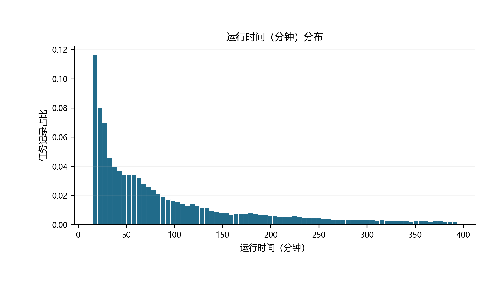

### 任务运行时间CDF

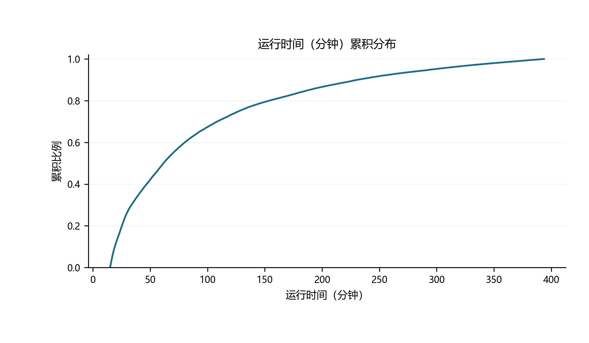

### CPU使用量分布

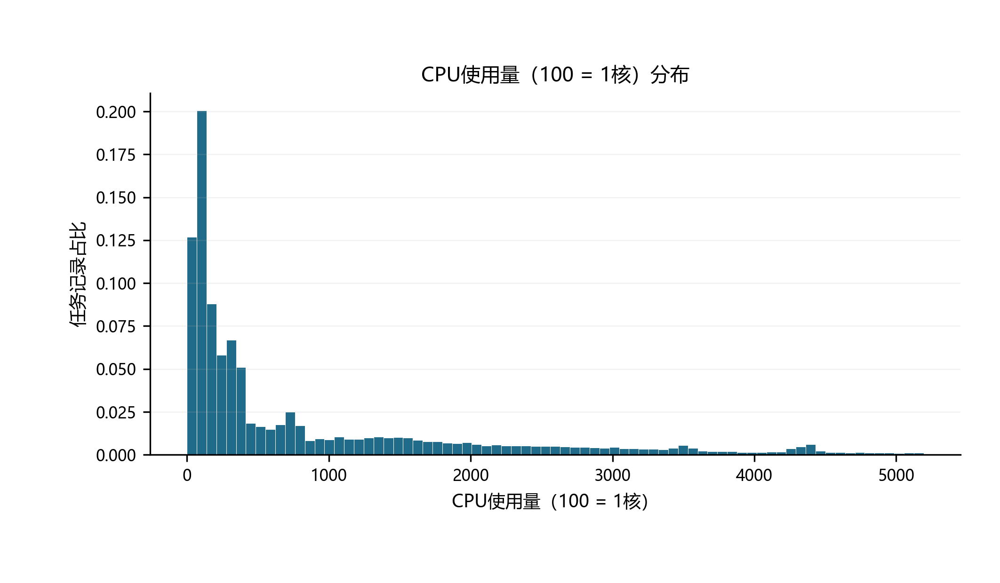

### GPU使用量分布

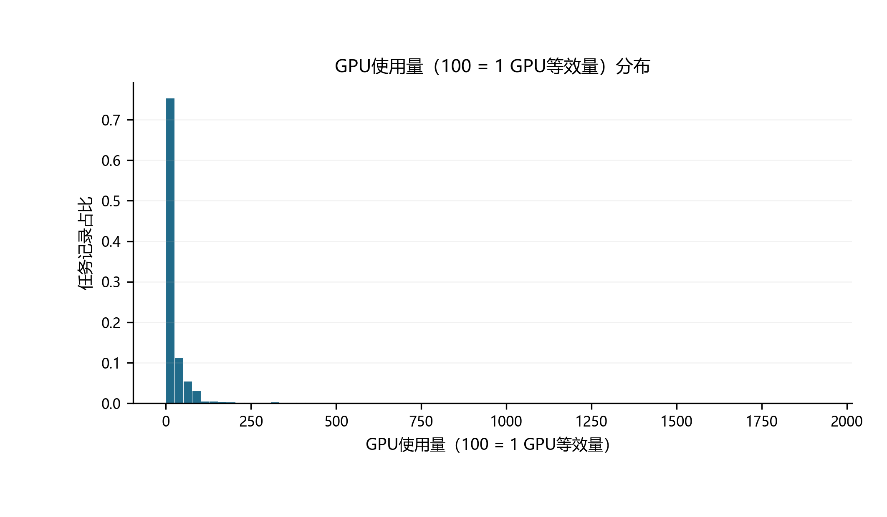

### 主存使用量分布

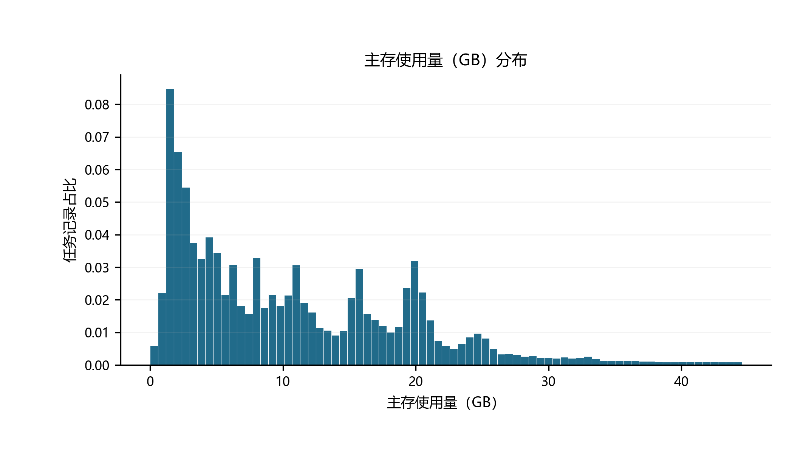

### 显存使用量分布

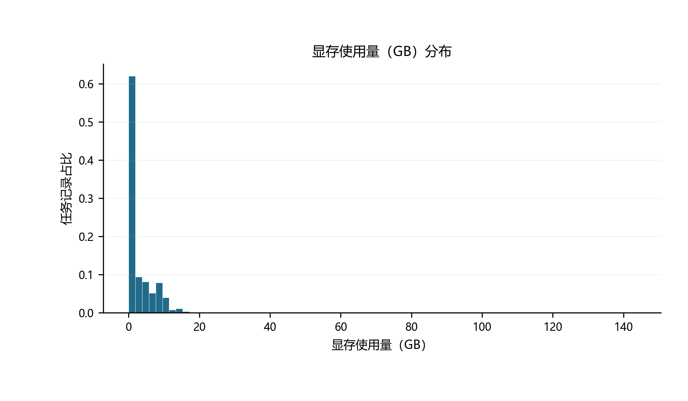

### 正确网络字段分布

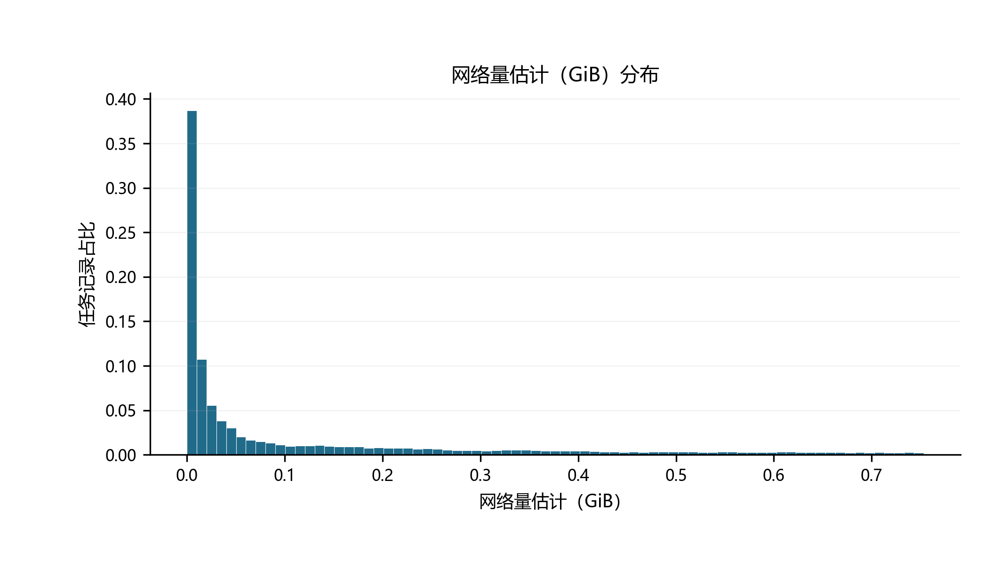

### 任务到达时间序列

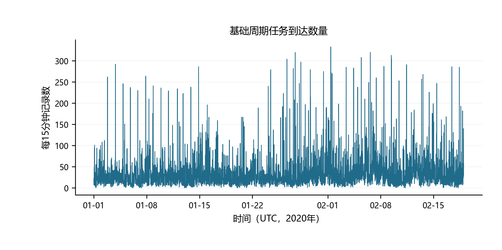

### 不同时间粒度的到达峰值比较

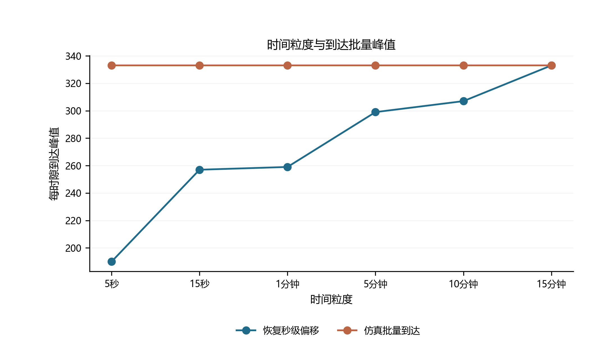

### UTC小时分布

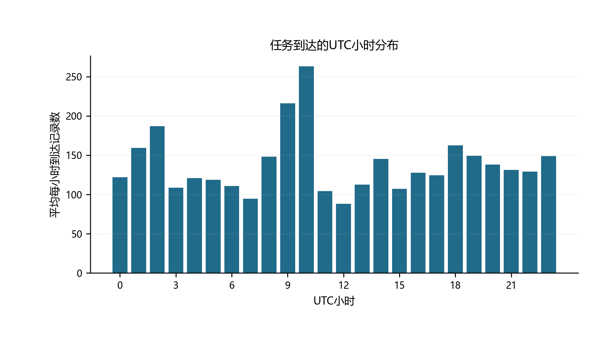

### 合成2020年星期分布

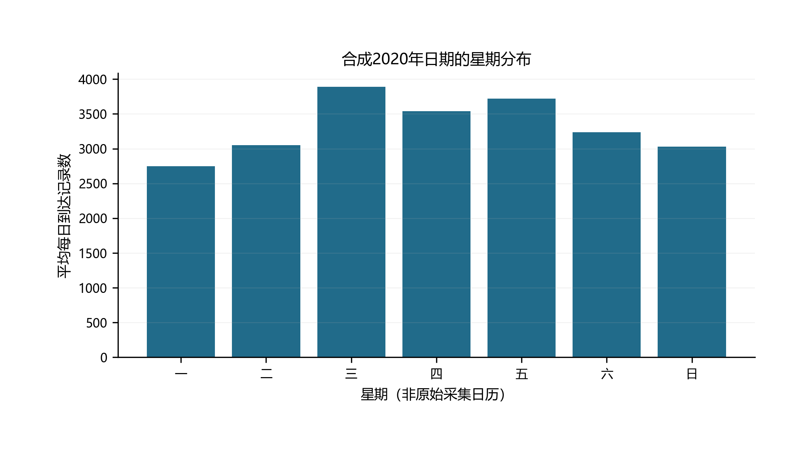

### CPU理论并发需求

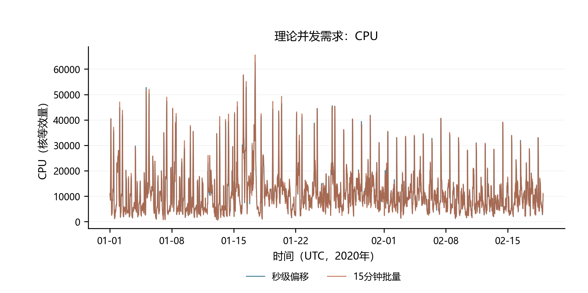

### GPU理论并发需求

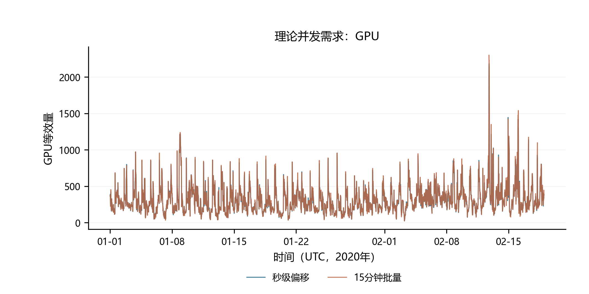

### 主存理论并发需求

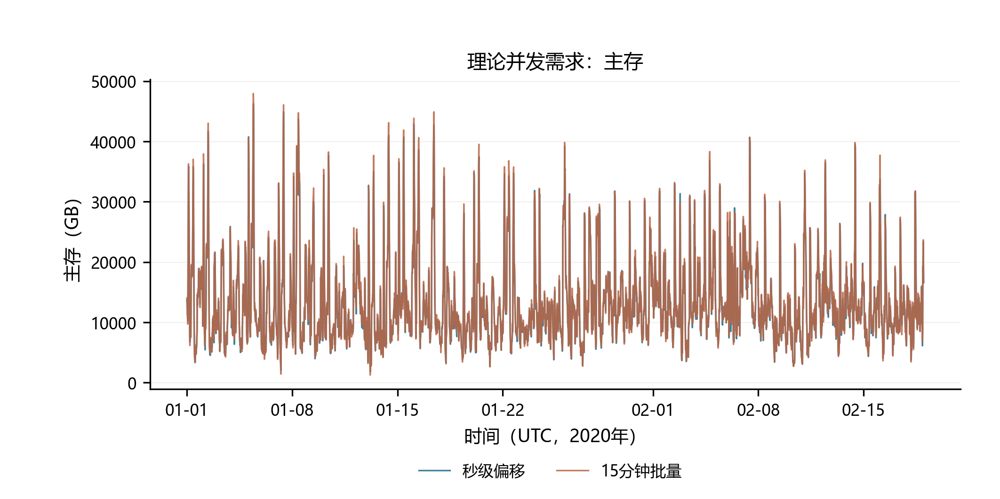

### 资源及持续时间相关性

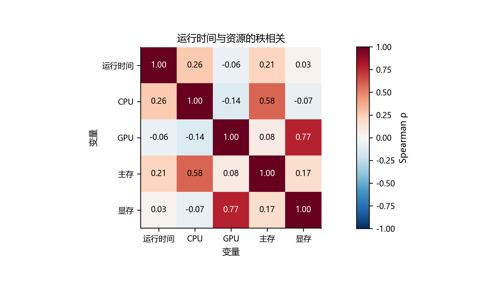

### 各中心GPU来源需求比较

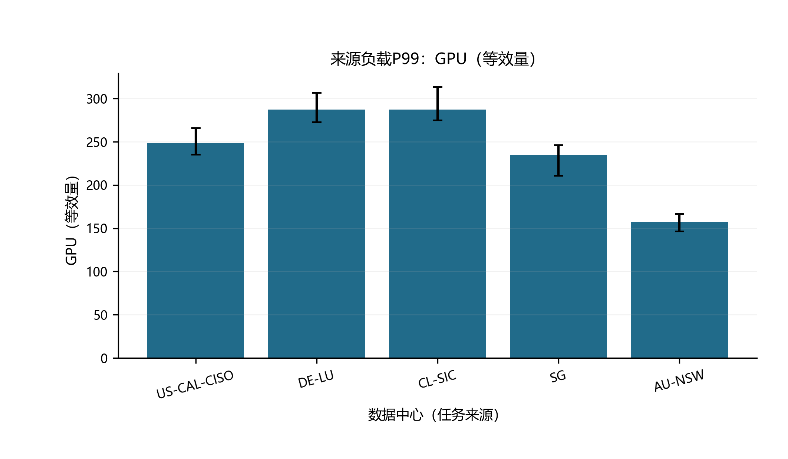

